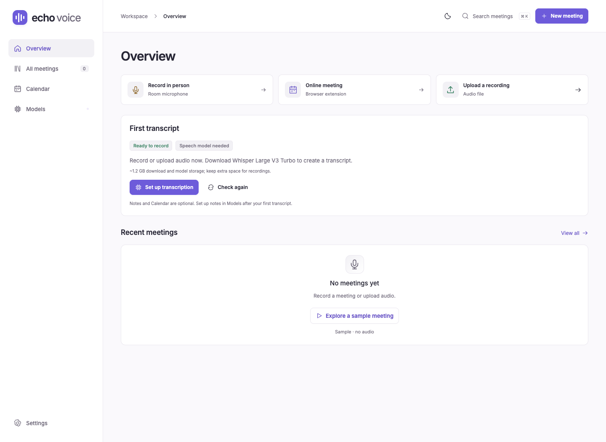

# Echo Voice

Record conversations, turn them into text, and create meeting notes. Echo keeps your library on your computer and opens in your existing Brave or Chrome browser.

**This branch is a development preview.** The local web app, simpler extension connection and encrypted storage are undergoing release checks. A Chrome Web Store listing has not been published. The [readiness record](docs/production-readiness-status.md) separates implementation, test evidence and remaining release gates.

## Start here

- **Use Echo:** follow [installation and first use](docs/install.md).
- **Record an online meeting:** follow [extension setup](docs/browser-extension.md).
- **Protect or move your recordings:** read [backup and recovery](docs/storage-and-recovery.md).
- **Build or contribute:** use the [developer guide](docs/development.md).

Current qualification targets are Brave and Chrome on Apple Silicon macOS 14+ and Ubuntu 24.04 x64. Each browser and meeting service needs its own test evidence. Check the [qualification matrix](docs/extension-qualification.md) before relying on a particular browser or meeting service.

## Set up Echo

Echo is a locally served web app. Start its local server, then open [http://localhost:3000](http://localhost:3000) in your existing Brave or Chrome browser. Initial setup currently requires a [source build](docs/development.md#build-and-start), including developer tools; after setup, recording and review happen in the browser. Keep the server running while using your library or transferring extension recordings. The [setup guide](docs/install.md) explains these two parts.

Before important recordings, save your library recovery phrase in **Settings → Storage → Protect your library**. Keep it privately in a password manager or another location you control. See [what the phrase protects](docs/storage-and-recovery.md).

### Record your first conversation

1. Choose **New meeting → In person**.
2. Choose **Test access**, allow microphone access and select your microphone.
3. Confirm that everyone has agreed to be recorded, then choose **Start recording**.
4. Speak for a few seconds with Echo and the workspace tab open.
5. Choose **Stop & save**, then play the saved meeting to check its audio.

Already have audio? Choose **Upload a recording** on Overview. Start with a short test before relying on Echo for an important meeting.

### Turn audio into text

1. For first-time setup, follow **First transcript** on Overview. **Set up transcription** opens Models; download the model named by the guide. You can also open **Models → Speech models** directly. The default, **Whisper Large V3 Turbo**, needs about 1.2 GB for speech and speaker models.
2. Wait for **Downloaded · ready to use**, then return to Overview. Recording and uploads remain available while the model downloads.
3. Choose **Open recording**, or open a saved meeting, then choose **Create transcript**.

To change an existing meeting's model, use its **Details → Processing choices → Speech recognition** selector and **Save choices**. Download that model in Models before transcribing. The default in Settings applies to new meetings; it does not replace the model saved with an existing meeting.

Downloads require internet access. Processing uses your computer and may take time. **Whisper Large V3**, about 1.7 GB, requires the local native engine and Node.js; follow [native speech setup](docs/native-speech.md).

Review names, numbers and speaker labels against the audio. You can correct passages, rename speakers and return to earlier transcript or notes versions. Speaker grouping is approximate, especially with short or overlapping speech. The [three AMI sample reports](docs/ami-accuracy-2026-10-05.md) document measured results and limitations.

### Create notes

Notes are optional and use a completed transcript.

- **Local notes:** install and start [Ollama](https://ollama.com/download), then use **Models → Local notes** to check its connection and download a notes model.
- **ChatGPT notes:** follow [account setup](docs/chatgpt.md). Each confirmed request sends the **entire selected transcript version, including speaker labels, to OpenAI**. Selecting passages does not narrow that request. Audio stays local; there is no automatic API-billing fallback.

Open the meeting's **Notes** tab and choose **Generate meeting notes**. Check generated decisions, dates and action items before sharing.

## Connect online meetings

The extension records the meeting you attend in your existing browser tab. Install it once, save its separate recovery phrase, choose **Connect to Echo**, and approve the connection in Echo. Setup finishes automatically. Codes and custom local addresses are under **Advanced connection settings**.

Join your meeting normally, open Echo from the toolbar, choose the audio sources, confirm participant consent and start. Your microphone is included only with permission and while the meeting is positively identified as unmuted. Unknown or stale meeting controls exclude your voice. Echo never requests camera access.

Closing the popup or switching tabs does not change the captured meeting. Closing the whole browser interrupts capture. The extension can continue while the Echo app is closed and transfer later. Follow [recording and offline recovery](docs/browser-extension.md) for limits, live text and exports.

Calendar is optional and read-only. **Open meeting** opens its link; it does not start recording. No Docker container, separate meeting browser or unattended meeting runner is required.

## Save a backup and update Echo

In **Settings → Storage**, confirm your recovery phrase, then choose **Export library**. Keep the encrypted backup outside the application folder. It includes meeting audio, text, saved versions, settings and vocabulary. Credentials, downloaded models and audio still pending in the extension are separate.

Restoring into an empty library on another computer requires the phrase saved for that backup. The extension has a separate recovery phrase for its pending browser recordings. Plain WAV and text exports are readable files; save them privately.

Before updating, finish recordings and synchronize or export pending extension audio. Export a backup, stop the local server, update and rebuild the source, then restart it with the same library path. Updates do not create a backup automatically. Preserve the old library and backup until the new build opens and plays your meetings. Use [installation and updates](docs/install.md), [update recovery](docs/update-recovery.md) and [storage recovery](docs/storage-and-recovery.md) for the exact steps. A change in extension identity needs an explicit migration; browser storage does not move automatically.

## Get help

| What you see | Next step |
|---|---|
| Echo cannot connect | Start the local server, keep it running and open its configured address in Brave or Chrome. |
| Library is locked | Unlock the operating system's credential store. If its key was lost, follow [library recovery](docs/storage-and-recovery.md#recover-a-locked-library) with the saved phrase. |
| Extension is disconnected | Start Echo, choose **Connect to Echo** in extension Setup and approve its request. |
| Microphone unavailable | Check OS and browser microphone permissions, or deliberately choose **Record call audio only**. |
| Saved audio but no transcript | Finish downloading the selected speech model, then choose **Create transcript**. |
| Extension history is locked | Open the paired Echo app or enter the extension recovery phrase in Setup. New offline recording can still work after initial setup. |
| In-person recording says **Retry save** | Keep its tab open, check disk space and retry before closing it. |
| Meetings missing after an update | Check the library path in Storage. Keep the original folder and backup. |

Contact [Samarth](mailto:samarth.m.n@gmail.com) with your OS, browser, build version and exact error. Do not send recovery phrases, account tokens, private meeting links or recordings. The planned support site is `echovoice.samarthmn.com`; its publication is tracked in the release record.

## For developers

Echo uses Dioxus/Rust WebAssembly, Axum, SQLCipher and encrypted audio storage, browser/native speech engines, and a Manifest V3 TypeScript extension. See [build and test instructions](docs/development.md), [architecture](docs/architecture.md) and the [documentation index](docs/README.md).

The [feature map](docs/feature-coverage.md) and [qualification record](docs/extension-qualification.md) describe limits. Earlier review evidence applies to its stated build; it does not establish that this preview or every platform has passed.
