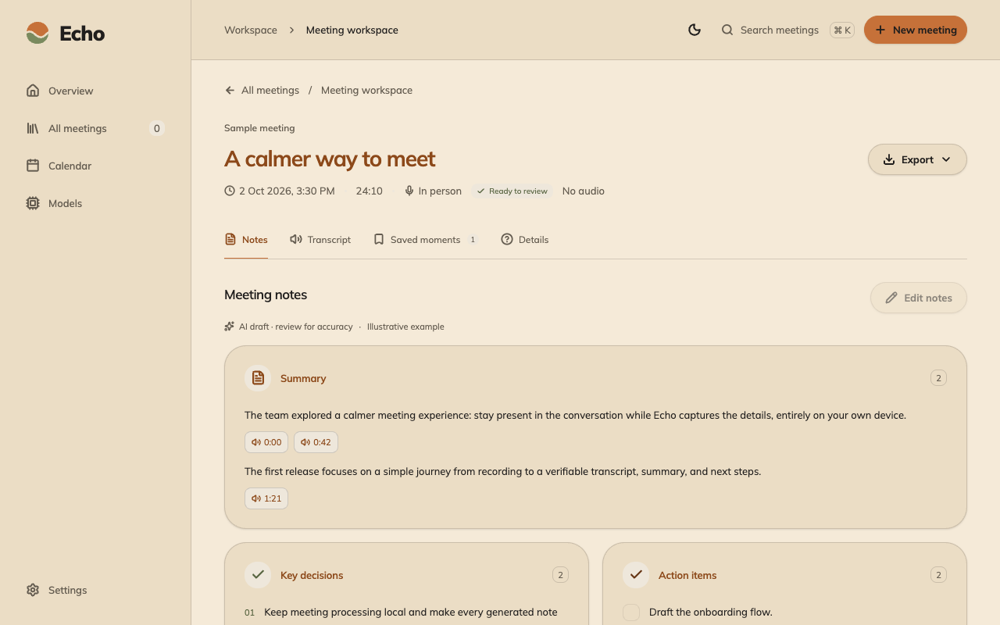

<!-- markdownlint-disable MD033 MD041 -- centred logo header -->
<p align="center">
  
</p>

# Echo: open-source, local AI meeting notes

**Record, transcribe and summarise your meetings on your own Mac.** Echo is a free, self-hosted alternative to Fireflies, Otter.ai and Fathom: no bot joins your call, there is no account, and your audio never leaves your laptop.

[](https://github.com/samarthmn/echo-voice-web/actions/workflows/verify.yml)
[](https://github.com/samarthmn/echo-voice-web/releases)
[](LICENSE)

[Website](https://echo-web.samarthmn.com) · [Documentation](https://echo-web.samarthmn.com/docs/) · [Install](docs/install.md) · [Changelog](CHANGELOG.md)



## Why Echo

Cloud notetakers send every meeting to someone else's servers and drop a bot into your calls. Echo does the same job, recording, transcription, speaker labels and notes, entirely on your Mac. It is a product you run yourself, not a service: nobody else ever handles your recordings.

## Features

- **No bot in your call.** A Brave or Chrome extension records the Google Meet, Zoom (web) or Microsoft Teams (web) tab you are already in.
- **Whisper on your Mac.** Transcribe with Whisper Large V3 Turbo in the browser or Large V3 natively. Works offline after the one-time model download.
- **Speaker grouping.** Who said what, computed locally with PyAnnote and WavLM. Rename speakers and correct passages; every edit is versioned.
- **Notes you can check.** Summaries, decisions and action items from a local [Ollama](https://ollama.com) model, each linked to the moment it came from.
- **Encrypted library.** SQLCipher database and encrypted audio, a key in the macOS Keychain, a 24-word recovery phrase and encrypted backups.
- **Recordings that survive.** The extension keeps audio encrypted in the browser until Echo is reachable, then uploads it.
- **More ways in.** Record in-person meetings with your microphone, upload existing audio, and see upcoming meetings from Google Calendar (read-only).

## How it compares

| | Echo | Fireflies | Otter.ai | Fathom |
| --- | --- | --- | --- | --- |
| Runs on your computer | Yes | No | No | No |
| Bot joins the call | No | By default | Yes | By default |
| Account needed | No | Yes | Yes | Yes |
| Open source | Yes (MIT) | No | No | No |
| Where data is stored | Your Mac, encrypted | Vendor cloud | Vendor cloud | Vendor cloud |

Sources and dates are in the [full comparison](https://echo-web.samarthmn.com/#compare).

## Quick start

You need an Apple Silicon Mac (macOS 14+), Xcode command line tools, Rust, Node.js 22.18+, pnpm, and Brave or Chrome. The [install guide](docs/install.md) covers each step from a fresh Mac.

```bash
git clone https://github.com/samarthmn/echo-voice-web.git
cd echo-voice-web
./scripts/setup.sh      # checks prerequisites, installs dependencies, builds everything
./scripts/start.sh      # serves Echo at http://localhost:3000
```

1. Open <http://localhost:3000> and allow Echo to use the Keychain.
2. Load the extension: `brave://extensions` (or `chrome://extensions`) → Developer mode → **Load unpacked** → `extension/dist`.
3. Save your recovery phrase in **Settings → Storage**.
4. Download a speech model under **Models**.
5. Join a meeting, open the Echo extension, and **Start recording**.

Something off? Run `./scripts/doctor.sh`. To start Echo at login, see [start at login](docs/auto-start.md); to update, run `./scripts/update.sh`.

## Documentation

| | |
| --- | --- |
| [Requirements](docs/requirements.md), [install](docs/install.md), [first recording](docs/first-recording.md) | Getting started |
| [Extension](docs/extension.md), [recording](docs/recording.md), [models](docs/transcription-models.md), [notes](docs/notes-ollama.md), [calendar](docs/calendar.md) | Using Echo |
| [Configuration](docs/configuration.md), [backups and recovery](docs/backups-and-recovery.md), [troubleshooting](docs/troubleshooting.md) | Self-hosting |
| [Security model](docs/security-model.md), [privacy](docs/privacy.md), [licences](docs/licenses.md) | Trust |
| [Architecture](docs/architecture.md), [development](docs/development.md), [releasing](docs/releasing.md) | Contributing |

The same pages are on [echo-web.samarthmn.com/docs](https://echo-web.samarthmn.com/docs/).

## Privacy and consent

Echo has no telemetry and never sends meeting data off your Mac; [privacy](docs/privacy.md) lists every network request it can make. Recording other people is regulated in many places. **You are responsible for getting consent and following the recording laws where you and the other participants are.** Echo asks you to confirm consent before every recording.

## Contributing

Bug reports, fixes and ideas are welcome. Read [CONTRIBUTING.md](CONTRIBUTING.md), and please report security issues privately as described in [SECURITY.md](SECURITY.md).

## Licence

[MIT](LICENSE). Mulish is under the SIL Open Font License; speech models have their own licences, listed in [licences](docs/licenses.md).
