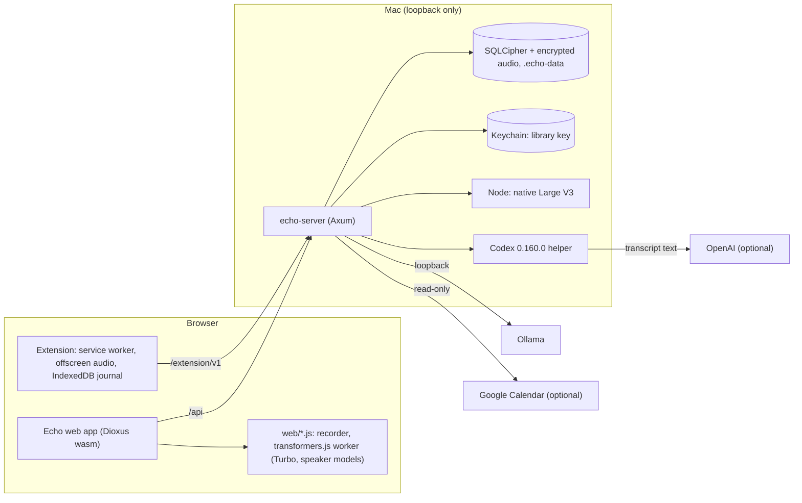

# Architecture

## Components

## Request flow

The server (`server/src/main.rs`) serves the static `public/` folder and two route trees on a loopback address. `/api` is for the same-origin web app and passes the `local_access` middleware (Host and Origin checks, no-store). `/extension/v1` is for the extension and has its own middleware (loopback Host, `chrome-extension://` Origin, bearer credentials, CORS for that origin only). All responses get no-cache, nosniff, frame-deny and no-referrer headers. The web app calls `/api` for data and runs speech models in the browser, except Large V3, which it hands to the server as a native job.

## Server modules (`server/src/`)

| Module                                       | Role                                                                                                                                                                                              |
| -------------------------------------------- | ------------------------------------------------------------------------------------------------------------------------------------------------------------------------------------------------- |
| `main.rs`                                    | Startup, router, `--recover-library` and `--check-library`, graceful shutdown                                                                                                                     |
| `config.rs`, `paths.rs`                      | `echo.config.json`, env overrides, resource root, data and runtime dirs                                                                                                                           |
| `security.rs`                                | Local-access and browser-isolation middleware, `ApiError`                                                                                                                                         |
| `protected_storage.rs`                       | Keychain-held library key, authenticated files                                                                                                                                                    |
| `store/`                                     | `mod.rs` (database open, lock, migrations), `meetings.rs`, `audio.rs`, `settings.rs`, `vocabulary.rs`, `library_io.rs` (export/import), `validation.rs`                                           |
| `library_schema.rs`, `library_validation.rs` | Format fence and offline library check                                                                                                                                                            |
| `recovery.rs`                                | Recovery phrase, encrypted backups, `--recover-library`                                                                                                                                           |
| `extensions/`                                | `mod.rs` (routes, auth, connections), `pairing.rs` (v2 pairing, intents), `recordings.rs` (chunk ingest), `live.rs` (live text), `workspace.rs` (`/api/extensions/*`), `vault.rs` (legacy escrow) |
| `speech.rs`, `speech_spool.rs`               | Native Large V3 jobs and encrypted PCM spool                                                                                                                                                      |
| `notes.rs`                                   | Ollama and ChatGPT notes generation                                                                                                                                                               |
| `chatgpt.rs`, `chatgpt_runtime.rs`           | Codex app-server bridge, encrypted sparse-image home                                                                                                                                              |
| `integrations.rs`, `google_oauth.rs`         | Google Calendar and its OAuth flow                                                                                                                                                                |
| `api.rs`                                     | Meetings, settings, storage and other workspace routes                                                                                                                                            |

## Other code

- `app/src/`: Dioxus UI (`main.rs`, `settings.rs`, `models.rs`, `calendar.rs`, `extension.rs`, `chatgpt.rs`, `privacy.rs`, `review.rs`, `onboarding.rs`, `api.rs`, `ui.rs`).
- `web/`: browser JS bridges: recorder, `inference*.js` and `models.js` (speech and speaker models), `diarization.js`, `native-speech.js`, `extension-*.js` (extension connection, approval dialog, live text, import).
- `scripts/native-speech.mjs`: the Node helper for Large V3.
- `extension/src/` (below).

## Extension modules (`extension/src/`)

| Module                                                                               | Role                                                                     |
| ------------------------------------------------------------------------------------ | ------------------------------------------------------------------------ |
| `background.ts`                                                                      | Service worker: message routing, migration, upload scheduling            |
| `popup.ts`, `setup.ts`, `ui.ts`, `connection-card.ts`, `status-labels.ts`            | Popup and Setup pages                                                    |
| `pairing.ts`, `connection.ts`, `discovery.ts`, `external-messages.ts`, `protocol.ts` | Pairing, link state, finding Echo, messages from Echo pages, HTTP client |
| `settings.ts`                                                                        | Sealed link state and settings                                           |
| `content.ts`, `adapters.ts`, `compatibility.ts`                                      | Meeting-page observer and mute-state adapters (Meet, Zoom, Teams)        |
| `offscreen.ts`, `audio.ts`, `worklet.ts`, `recording-lock.ts`                        | Tab/mic capture, resampling to 16 kHz PCM, single-recording lock         |
| `storage.ts`, `encryption.ts`, `device-secrets.ts`, `vault-db.ts`, `legacy-vault.ts` | Encrypted IndexedDB journal, device key, migration of older recordings   |
| `library-actions.ts`                                                                 | Upload, export and delete of local recordings                            |

## Recording data flow

1. The popup asks the service worker to start; `tabCapture` (plus optional microphone) feeds the offscreen document, which resamples to mono 16 kHz PCM16 and gates the microphone on the content script's mute state.
2. About one-second chunks are encrypted with the recording's key and committed to the IndexedDB journal.
3. When connected and Echo answers `/hello`, chunks are `PUT` to `/extension/v1/recordings/{id}/chunks/{sequence}` and finished with `complete`. The server stores them encrypted under `extension-pcm/` and creates the meeting. The extension drops its copy once the import is confirmed.
4. In Echo, the meeting's audio is processed: Turbo in the browser or Large V3 through the server, plus speaker grouping, producing a transcript version stored in the library.
5. Notes are generated from a transcript version by Ollama or, on confirmation, ChatGPT, and saved as a notes version.
